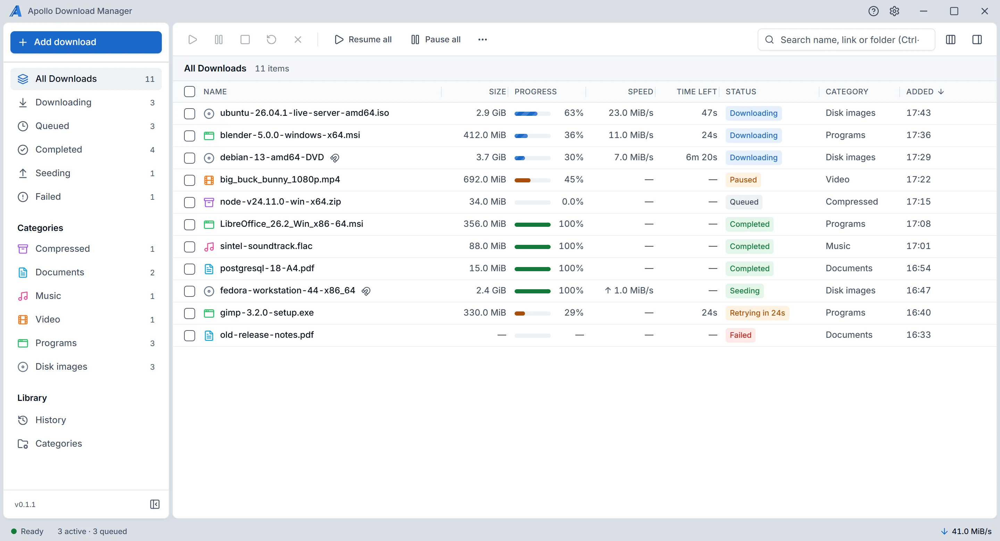

<div align="center">

<picture>
  <source media="(prefers-color-scheme: dark)" srcset="assets/brand/apollo-lockup-dark.svg">
  
</picture>

**A free download manager for Windows and Linux.**<br>
Resumes after a break, sorts files into folders, and takes downloads from your browser. Torrents, FTP and SFTP too.

[Website](https://singlbase-technologies-limited.github.io/apollo-download-manager/) ·
[Download](https://singlbase-technologies-limited.github.io/apollo-download-manager/download/) ·
[User guide](https://singlbase-technologies-limited.github.io/apollo-download-manager/guide/) ·
[Developer docs](https://singlbase-technologies-limited.github.io/apollo-download-manager/developers/) ·
[Report a problem](https://github.com/Singlbase-Technologies-Limited/apollo-download-manager/issues/new/choose)

[](https://github.com/Singlbase-Technologies-Limited/apollo-download-manager/releases)
[](LICENSE)
[](https://github.com/Singlbase-Technologies-Limited/apollo-download-manager/actions/workflows/main.yml)

<picture>
  <source media="(prefers-color-scheme: dark)" srcset="site/screens/dark.webp">
  
</picture>

</div>

## Why Apollo Download Manager

- **Picks up where it stopped.** Resumes after a break, once it has checked the file hasn't changed.
- **Several connections over HTTP and HTTPS.** Up to 8 per file, kept only while they make it faster.
- **Torrents built in.** Magnet links and `.torrent` files, with seeding.
- **Takes downloads from your browser.** An extension for Chrome, Edge, Brave and Firefox hands links to the app.
- **Tells you why.** When a download waits or fails, it says so in plain words.
- **Private by design.** No telemetry and no analytics: it connects only to the servers you download from.

| Links | Connections per file | Resumes | Logins |
|---|---|---|---|
| `http://`, `https://` | Up to 8, kept only while they make it faster | Yes | Password, custom headers |
| `ftp://`, `ftps://` | One | Yes | Password |
| `sftp://` | One | Yes | Password, SSH key |
| Magnet links, `.torrent` | As many peers as it finds | Yes | None needed |

Metalink files work too, once turned on in Settings. Logins, custom headers and SSH keys stay out of its database and logs. The full list, with the limits, is in the user guide's [Protocols and limits](docs/user/protocols.md).

## Install

Get the Windows installer, or the `.deb` (Ubuntu, Debian) or `.rpm` (Fedora, openSUSE) package, from the [download page](https://singlbase-technologies-limited.github.io/apollo-download-manager/download/) or [GitHub Releases](https://github.com/Singlbase-Technologies-Limited/apollo-download-manager/releases). The [Installing](docs/user/installing.md) guide has the steps.

> [!NOTE]
> **Still in development.** The releases are test builds made by the project's CI, and they aren't signed yet, so Windows SmartScreen warns on first run. The [user guide](docs/user/README.md) says what this version does.

The browser extension is set up from the app: Settings, Browser ([Browser integration](docs/user/browser.md)). Chrome and Brave get it from the [Chrome Web Store](https://chromewebstore.google.com/detail/fhhohpcahhmlijibcpppoddcklobfpld); the Edge and Firefox store pages follow.

## Build from source

```sh
pnpm check:prereqs
pnpm install --frozen-lockfile
pnpm dev
```

The full setup for Windows and Linux is in [docs/DEVELOPMENT.md](docs/DEVELOPMENT.md), and common problems are in [docs/TROUBLESHOOTING.md](docs/TROUBLESHOOTING.md). Apollo Download Manager is a Tauri 2 and React app with its own Rust download engine (libcurl for HTTP, HTTPS and FTP, russh for SFTP) and libtorrent for torrents; the [architecture](docs/ARCHITECTURE.md) explains the parts.

## Documentation

| For | Where |
|---|---|
| Using the app | The [user guide](docs/user/README.md), also in the app (Help, User guide) and on the [website](https://singlbase-technologies-limited.github.io/apollo-download-manager/guide/) |
| Building and changing it | The [developer site](https://singlbase-technologies-limited.github.io/apollo-download-manager/developers/), with search, and the [map of every document](docs/README.md) |
| Why it is the way it is | The [decision records](docs/decisions/README.md) |

## Contributing

Work is planned as issues on the [project board](https://github.com/orgs/Singlbase-Technologies-Limited/projects/4). Start with [CONTRIBUTING.md](CONTRIBUTING.md). Contributors agree to the [Contributor Licence Agreement](CLA.md) and the [Code of Conduct](CODE_OF_CONDUCT.md). The rules for contributors and AI agents are in [AGENTS.md](AGENTS.md).

**Security problems:** please report them privately, as [SECURITY.md](SECURITY.md) describes. **Help:** see [SUPPORT.md](SUPPORT.md).

## Licence

Copyright (C) 2026 Singlbase Technologies Limited. Apollo Download Manager is free software under the [GNU General Public License, version 3 only](LICENSE) (`GPL-3.0-only`), without any warranty ([ADR-0017](docs/decisions/0017-gpl-3-licence.md)). The third-party components it contains, and their licences, are in [THIRD_PARTY_NOTICES.md](THIRD_PARTY_NOTICES.md).

Apollo Download Manager is a separate app from the original Velocity Download Manager, and installs beside it. Until 0.2.0 it was named "Velocity Download Manager V2" ([ADR-0018](docs/decisions/0018-product-name-apollo.md)).
